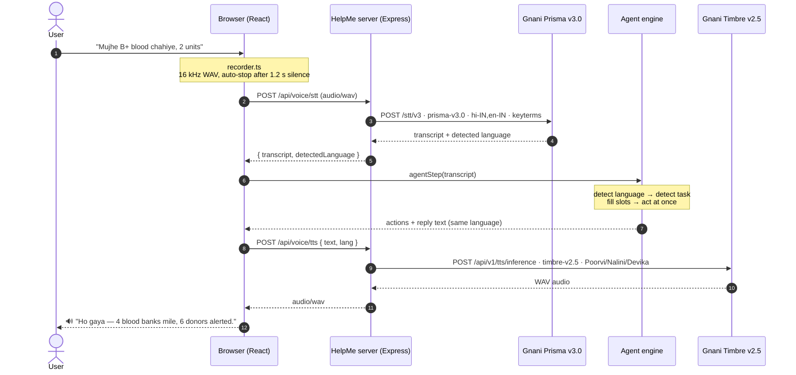
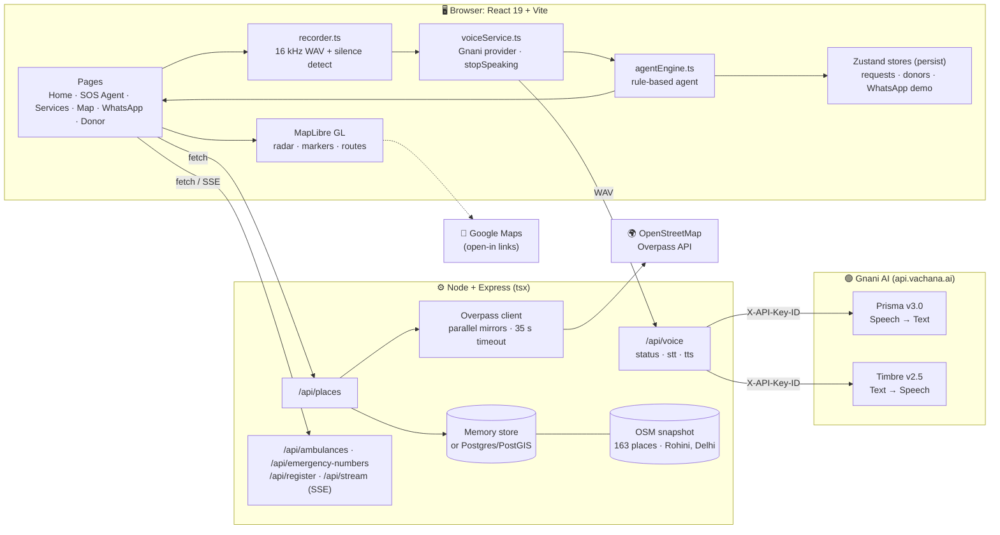
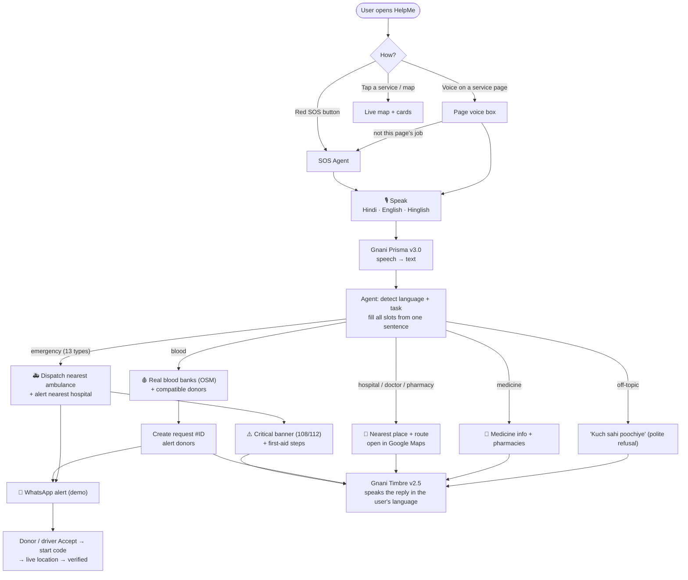
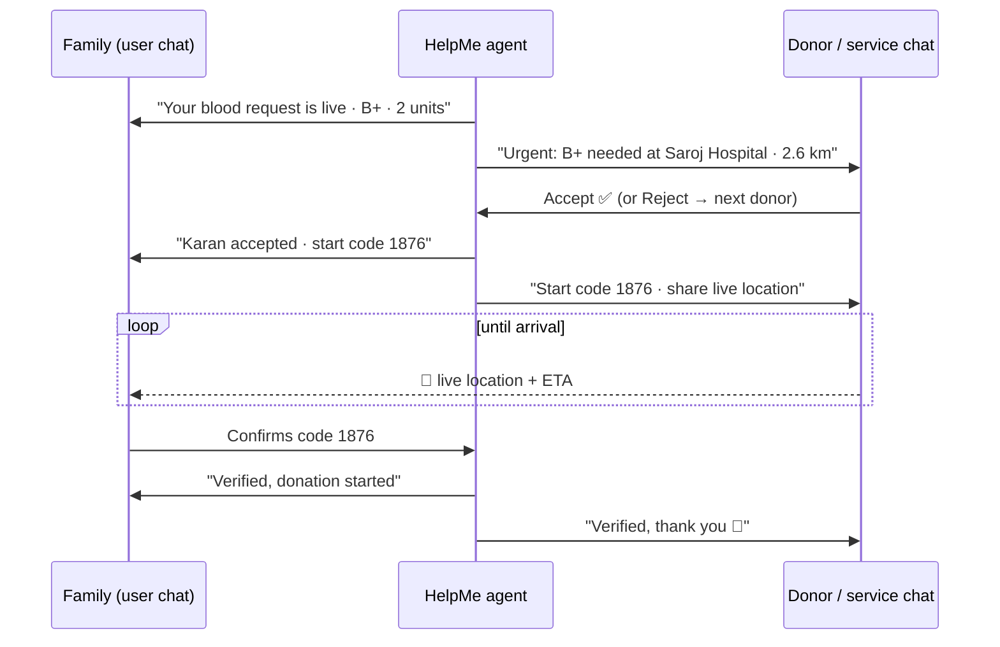
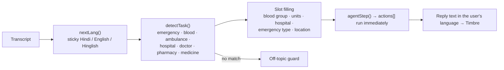

<div align="center">

# 🩺 HelpMe

### Emergency medical help for India, one sentence away.

**Speak in Hindi, English or Hinglish. HelpMe understands you, acts immediately, and replies in your language.**
**Voice runs on [Gnani AI](https://gnani.ai): Prisma for speech-to-text and Timbre for text-to-speech.**

`React 19` · `TypeScript` · `Vite 8` · `Tailwind v4` · `Express` · `MapLibre` · `OpenStreetMap` · **`Gnani Prisma v3.0`** · **`Gnani Timbre v2.5`**

Built by **Vansh Singla** ([vs.vansh19@gmail.com](mailto:vs.vansh19@gmail.com)) for Gnani AI's **Great Indian AI Internship Challenge**

`#GnaniAI` `#GreatIndianAIInternshipChallenge`

</div>

---

## Table of contents

1. [Why HelpMe](#1-why-helpme)
2. [What it does (features)](#2-what-it-does)
3. [How Gnani AI is used](#3-how-gnani-ai-is-used-on-every-voice-call)
4. [Architecture](#4-architecture)
5. [Workflow diagrams](#5-workflow-diagrams)
6. [The SOS agent engine](#6-the-sos-agent-engine)
7. [Data sources](#7-data-sources)
8. [Tech stack](#8-tech-stack)
9. [Project structure](#9-project-structure)
10. [API reference](#10-api-reference)
11. [Setup and running](#11-setup-and-running)
12. [Environment variables](#12-environment-variables)
13. [Try it: demo script](#13-try-it-demo-script)
14. [Security and privacy](#14-security-and-privacy)
15. [Impact](#15-impact)
16. [Limitations and roadmap](#16-limitations-and-roadmap)

---

## 1. Why HelpMe

It's 2 AM and Papa has sudden chest pain. The family panics: *which hospital? where do we get blood? when will the ambulance come?* Every app in this moment expects you to type in English, scroll through lists and make phone calls.

- India records **1,72,890 road-crash deaths a year** (MoRTH, 2023), about **474 a day**.
- **~50,000 deaths a year** could be prevented with timely trauma care (AIIMS-led expert committee).
- India needs about **14.6 million blood units a year** (Govt. of India, 2025).
- Only **~10.6% of Indians speak English** (Census 2011).

**HelpMe turns one spoken sentence into action.** It finds the nearest hospital, dispatches an ambulance, finds blood banks, alerts compatible donors and reads out first aid, in the language the person is already speaking.

---

## 2. What it does

| Feature | What happens | Gnani AI |
|---|---|---|
| **SOS agent** (`/agent`) | Voice chat on the right, an agent working on its own on the left. It pulls every detail from one sentence and **acts immediately, without asking for confirmation**. | Prisma (in) + Timbre (out) on every turn |
| **13 emergency types** | Head injury, accident, pregnancy/labour, unconscious, chest pain, breathing, stroke, burns, bites, seizure, poisoning, sugar, allergy. Critical cases trigger an ambulance plus a red banner. | First aid is **spoken** by Timbre |
| **Blood requests** | Reads blood group, units and hospital, finds real blood banks, matches **compatible** donors (e.g. O− gives to all) and sends alerts. | Hinglish confirmation via Timbre (Poorvi) |
| **Voice on every page** | Hospitals, Blood, Ambulance, Doctors and Pharmacy each have an "Ask by voice" box that acts on that page; anything else is **handed to the SOS agent** pre-filled. | Prisma + Timbre |
| **AI helper** (`/voice`) | Greets first in Hinglish, then answers medicine, place and route questions. | Prisma + Timbre |
| **Live map** (`/map`, home) | Real OSM hospitals, pharmacies, blood banks and clinics; radar scan animation, markers pop in, search, photo filter tiles, zoom-to-me, open in Google Maps, route line. | — |
| **WhatsApp alerts (demo)** (`/whatsapp`) | Family and donor/service chats, Accept/Reject, 4-digit start code, live location, verified start. Syncs live across browser tabs. | The agent pushes every request here |
| **Donor registration** (`/donor/register`) | 5 steps: details → blood group → Aadhaar photo (sample) → live selfie (sample) → done. | — |
| **Onboarding + walkthrough** | Language and role choice; a first-visit guided tour (SOS agent → services → map → Evaluation). | — |
| **Evaluation panel** (hero button) | For judges: Video, Workflow (Mermaid diagram plus how Gnani is used) and Full details tabs. | — |
| **Languages** | UI in English and Hindi (i18next); the agent detects Hindi, English or Hinglish and **keeps the user's language** for the rest of the conversation. | Timbre voice is chosen per language |

---

## 3. How Gnani AI is used on every voice call

> **Every voice request = 1 Gnani Prisma call (speech → text) + 1 Gnani Timbre call (text → speech).**
> There is no other speech engine in the voice path. Gnani is the ears and the mouth of HelpMe.

### Models used

| Stage | Gnani model | Endpoint | Settings used by HelpMe |
|---|---|---|---|
| **Speech-to-text** | **Prisma v3.0** (`prisma-v3.0`) | `POST https://api.vachana.ai/stt/v3` (multipart) | `audio_file` = 16 kHz mono WAV · `language_code` = `hi-IN,en-IN` (code-mixed Hinglish) · `keyterms` = medical vocabulary (hospital, ambulance, blood, donor, B positive …) for higher accuracy |
| **Text-to-speech** | **Timbre v2.5** (`timbre-v2.5`) | `POST https://api.vachana.ai/api/v1/tts/inference` (JSON) | Voice picked per language: **Nalini** (`hi-IN`) · **Devika** (`en-IN`) · **Poorvi** (`hi-en`, Hinglish) · `audio_config`: WAV, 24 kHz, 16-bit |
| Auth | — | header `X-API-Key-ID` | The key lives only in server `.env` |

### Gnani round trip



### Gnani-specific engineering

- **Server-side proxy**: `server/src/routes/voice.ts`. The browser never sees the key.
- **Hinglish first**: STT asks for `hi-IN,en-IN` together so code-mixed speech ("Papa ko chest pain") is transcribed correctly.
- **Medical key terms** are sent with each STT call. If the API rejects them, the call is retried once without.
- **One consistent voice**: when Gnani is the provider, the browser's built-in speech is never mixed in (that used to produce male/female voice switching).
- **Interruptible speech**: `stopSpeaking()` cancels the current Timbre audio and resolves the pending promise, so the user can talk over the agent.
- **Verified end to end**: `server/scripts/test-gnani.mjs` does a Timbre → Prisma round trip. Sample result: *"मुझे B positive blood चाहिए, दो units जल्दी।"*
- **Fallback (development only)**: with no `GNANI_API_KEY`, the app falls back to the browser's Web Speech API so the UI can still be developed.

---

## 4. Architecture



**Design choices**

| Decision | Why |
|---|---|
| Gnani is called through a **server proxy** | Keeps the API key secret and lets us add retries, key terms and voice selection in one place |
| The agent is **rule-based, not an LLM** | Instant, predictable, works offline once loaded, and never invents medical advice. First-aid text is fixed and reviewed. |
| **Act first, ask later** | In emergencies a confirmation question wastes seconds. The agent starts with defaults (current location, nearest place) and corrects as the user adds detail. |
| **OSM + bundled snapshot** | Real, free, open data. Overpass mirrors are queried in parallel (`Promise.any`) and the bundled snapshot means the demo never shows an empty map. |
| **Zustand persist + `storage` events** | The WhatsApp demo syncs live between two tabs (family and donor) with no backend needed |

---

## 5. Workflow diagrams

### Full user workflow (also in the in-app Evaluation panel)



### WhatsApp demo flow



---

## 6. The SOS agent engine

File: `src/services/agent/agentEngine.ts`



- **Language**: Devanagari → Hindi; Hinglish markers (`chahiye`, `kahan`, `jaldi` …) → Hinglish; otherwise English. Once chosen, the language stays for the session unless the user clearly switches.
- **Emergencies**: 13 entries, each with keywords (English, Hindi and Hinglish), a `critical` flag and spoken first-aid steps.
- **Blood matching**: `COMPATIBLE` table for recipient → donor groups (e.g. AB+ receives from all, O− only from O−).
- **No confirmation loop**: the old "kya main shuru kar doon?" step was removed; the agent acts on the first sentence.
- **Interrupt queue**: if the user speaks while the agent is talking, speech stops and the new sentence is processed.
- **Hand-off**: service pages send `/agent?q=<transcript>` so the agent starts with the request already filled.

---

## 7. Data sources

| Data | Source | Notes |
|---|---|---|
| Hospitals, clinics, pharmacies, blood banks | **OpenStreetMap** via Overpass API | Mirrors queried in parallel; bundled snapshot `server/data/osm-rohini-delhi.json` (163 real places) |
| Map tiles | Esri / MapLibre styles | Optional Mapbox Directions for routes |
| Emergency numbers | 112 / 108 / 102 (built in) | `/api/emergency-numbers` |
| Donors, ambulances | Sample data (demo) | Clearly marked "demo" in the UI |
| Photos | Wikimedia Commons (`Special:FilePath`), randomuser.me avatars, generated doctor images | `src/lib/images.ts` |

---

## 8. Tech stack

| Layer | Technology |
|---|---|
| **Voice AI** | **Gnani Prisma v3.0 (STT)** · **Gnani Timbre v2.5 (TTS)**: Nalini, Devika, Poorvi |
| Frontend | React 19 · TypeScript · Vite 8 · Tailwind CSS v4 (`@theme` tokens) · React Router 7 · Zustand 5 (persist) · Framer Motion · Lucide icons · react-i18next |
| Maps | MapLibre GL 6 · Mapbox GL (optional) · OpenStreetMap / Overpass |
| Diagrams | Mermaid (loaded from a CDN at runtime in the Evaluation panel) |
| Backend | Node · Express 4 · tsx · zod · dotenv · cors · SSE for live updates |
| Database | In-memory store by default; optional Postgres + PostGIS (`docker-compose.yml`, `server/src/db/migrate.sql`) |
| Audio | Web Audio API: mic capture → downsample to 16 kHz → WAV encode in the browser |
| Tooling | oxlint · prettier · TypeScript project references |

---

## 9. Project structure

```
gnani-ai/
├── server/                         # Express API
│   ├── src/
│   │   ├── routes/voice.ts         # ⭐ Gnani proxy: /status, /stt (Prisma), /tts (Timbre)
│   │   ├── routes/places.ts        # nearby hospitals / pharmacies / blood banks
│   │   ├── routes/ambulances.ts · emergency.ts · register.ts · stream.ts · admin.ts
│   │   ├── overpass/               # Overpass client (parallel mirrors), query, normalize
│   │   ├── ingest/                 # area ingest + snapshot loader
│   │   ├── db/                     # memory store, Postgres client, migrate.sql
│   │   ├── jobs/                   # nightly refresh, SSE hub
│   │   ├── config.ts               # env config (gnani*, overpass mirrors …)
│   │   └── index.ts                # app wiring
│   ├── data/osm-rohini-delhi.json  # 163 real OSM places (offline demo)
│   └── scripts/test-gnani.mjs      # ⭐ Gnani TTS→STT round-trip test
├── src/
│   ├── services/
│   │   ├── voice/voiceService.ts   # ⭐ Gnani provider, speak/listen/stopSpeaking
│   │   ├── voice/recorder.ts       # ⭐ 16 kHz WAV recorder, silence auto-stop
│   │   ├── voice/intent.ts         # page-level intent parser
│   │   ├── agent/agentEngine.ts    # ⭐ SOS agent: languages, emergencies, blood matching
│   │   ├── demoWhatsApp.ts         # WhatsApp demo store (cross-tab sync)
│   │   └── places/donor/request/routing/ambulance services
│   ├── pages/                      # Home, Agent, Voice, Hospitals, Blood, Ambulance,
│   │                               # Doctors, Pharmacy, Map, WhatsApp, DonorRegister, Onboarding …
│   ├── components/
│   │   ├── map/MapCanvas.tsx · MapPanel.tsx
│   │   ├── voice/PageVoice.tsx     # voice box on every service page
│   │   ├── evaluation/EvaluationModal.tsx   # judges' panel + Mermaid workflow
│   │   ├── tour/Walkthrough.tsx    # first-visit guided tour
│   │   └── layout/ · ui/
│   ├── i18n/                       # English + Hindi
│   └── lib/                        # api, geo, images, maplibre setup
├── docs/MISSION.md
└── docker-compose.yml              # optional PostGIS
```

---

## 10. API reference

| Method | Path | Body / query | Returns |
|---|---|---|---|
| GET | `/api/health` | — | server status |
| GET | `/api/voice/status` | — | `{ gnani: boolean, stt, tts }` |
| POST | `/api/voice/stt` | raw `audio/wav`, `?lang=hi\|en` | `{ transcript, detectedLanguage }` (via **Gnani Prisma**) |
| POST | `/api/voice/tts` | `{ text, lang: "hi" \| "en" \| "hi-en" }` | `audio/wav` (via **Gnani Timbre**), header `X-Voice` |
| GET | `/api/places` | `lat, lng, radius, type` | nearby OSM places |
| GET | `/api/ambulances` | `lat, lng` | nearby ambulances (demo) |
| GET | `/api/emergency-numbers` | — | 112 / 108 / 102 … |
| POST | `/api/register` | provider details | registration record |
| GET | `/api/stream` | — | Server-Sent Events (live updates) |

---

## 11. Setup and running

**Requirements:** Node 20+ and npm. Docker is only needed for the optional PostGIS database.

```bash
git clone https://github.com/provanshh/gnani-ai.git
cd gnani-ai

npm install
npm install --prefix server

cp .env.example .env          # add your GNANI_API_KEY here (read by the server only)

# check that your Gnani key works (TTS → STT round trip)
cd server && node scripts/test-gnani.mjs && cd ..

# run API (http://localhost:3001) and web app (http://localhost:5173)
npm run dev:server            # terminal 1
npm run dev                   # terminal 2
```

Vite proxies `/api` → `localhost:3001`. Production build: `npm run build`.

> On Windows, if `vite` or `tsx` is "not recognized", run `npm install` in **both** the root and `server/`.

---

## 12. Environment variables

| Variable | Where | Purpose |
|---|---|---|
| `GNANI_API_KEY` | server | **Gnani key** (from [app.gnani.ai/voice](https://app.gnani.ai/voice)). Never prefix with `VITE_`. |
| `GNANI_BASE_URL` | server | default `https://api.vachana.ai` |
| `GNANI_STT_MODEL` | server | default `prisma-v3.0` |
| `GNANI_TTS_MODEL` | server | default `timbre-v2.5` |
| `GNANI_VOICE_HI` / `_EN` / `_HINGLISH` | server | default `Nalini` / `Devika` / `Poorvi` |
| `PORT` | server | default `3001` |
| `DATABASE_URL` | server | optional Postgres/PostGIS; empty = in-memory store |
| `OVERPASS_ENDPOINTS` | server | comma-separated Overpass mirrors |
| `PLACES_REFRESH_DAYS` | server | snapshot refresh interval |
| `VITE_MAPBOX_TOKEN` | client | optional, for Mapbox directions |
| `VITE_API_BASE_URL` | client | empty = use the Vite proxy |

---

## 13. Try it: demo script

| Say this | What happens |
|---|---|
| "Mujhe B+ blood chahiye, 2 units, Saroj Hospital mein" | Blood request filled in one go → blood banks → compatible donors alerted → WhatsApp alert → Hinglish voice reply |
| "Papa ko chest pain ho raha hai" | Ambulance dispatched, **critical** banner, first aid spoken |
| "Accident ho gaya, sir pe chot hai" | Head injury / accident flow, nearest trauma hospital |
| "मुझे पास का अस्पताल दिखाओ" | Nearest hospital + route, Hindi voice (Nalini) |
| "Nearest pharmacy open now" | Pharmacy list + route, English voice (Devika) |
| "Who won the cricket match?" | Polite off-topic reply |

Open `/whatsapp` in a second tab to watch the family and donor chats update live.

---

## 14. Security and privacy

- Gnani keys are **server-only** and stored in `.env`, which git ignores.
- Audio goes browser → HelpMe server → Gnani and is **not stored** by HelpMe.
- The Aadhaar and selfie steps in donor registration are **samples only**; no real ID is uploaded or kept.
- Location is used only in the browser to sort nearby places; nothing is tracked in the background.
- First-aid content is fixed text, not generated, so it cannot be made up by a model.

---

## 15. Impact

| Who | How HelpMe helps |
|---|---|
| Families in a panic | One sentence instead of five apps and ten phone calls |
| People who don't read English or have low literacy | Speak and listen in Hindi or Hinglish via Gnani: no typing, no reading needed |
| Elderly people | Large tap targets, voice everywhere, a guided walkthrough |
| Blood donors | Only **compatible** donors are alerted, with a start code and live location for safe hand-off |
| Hospitals and services | Requests arrive with structured details (group, units, location, emergency type) |

---

## 16. Limitations and roadmap

**Current limitations (honest):** donors, ambulances and WhatsApp are **demo simulations**; place data is densest around Rohini, Delhi (bundled snapshot); the agent is rule-based.

**Next:**
- 📞 **Live phone-call agent** with **Bolna.ai** voice calls + Gnani Indic speech, so it works from **any phone, even a feature phone**
- 🗣️ More Gnani languages: Tamil, Telugu, Bengali, Marathi, Kannada, Gujarati …
- 💬 Real WhatsApp Business API alerts
- 🏥 Live bed and blood stock from hospitals (ABDM integration; an adapter stub exists in `server/src/adapters/abdm.ts`)
- 🚑 Real ambulance fleet tracking (108 / private operators)

---

<div align="center">

**HelpMe: madad, bas ek sentence door.**

Made with ❤️ in Delhi by **Vansh Singla** · [vs.vansh19@gmail.com](mailto:vs.vansh19@gmail.com) · [github.com/provanshh](https://github.com/provanshh)

Voice powered by **Gnani AI** (Prisma v3.0 + Timbre v2.5)

</div>
